

# ⚡ JobSpark

### Recrutamento com IA explicável, da triagem à admissão

*Cada candidato entrevistado. Cada nota com prova. A decisão continua humana.*

**[🌐 jobspark.com.br](https://jobspark.com.br)** · **[▶ Fazer uma entrevista de exemplo](https://jobspark.com.br/apply/cmqsox1sr0001s60119gn3xnl)**

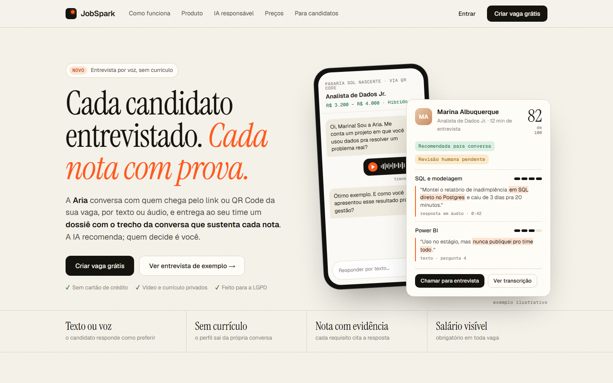

---

## 📌 Sobre este repositório

Esta é a **vitrine técnica** do JobSpark: o que o produto faz, como foi construído, a infraestrutura e a trilha da startup na Fase III. O **código-fonte é privado** para proteger a propriedade intelectual; o produto pode ser usado no ar em [jobspark.com.br](https://jobspark.com.br).

---

## 🚀 Startups — Fase III da Residência SiDi / Softex

O JobSpark é a startup inscrita por **Idarlan Magalhães** (residente do CTE-IA, Residência em TIC 44) no **Edital nº 03/2026 — Fase III: Capacitação Empreendedora de IA**, como startup interna.

**Estágio:** MVP em produção, sem clientes pagantes ainda. Mais detalhes em **[docs/startups](docs/startups/README.md)** e no **[cronograma mês a mês](docs/startups/cronograma.md)**.

### Etapas

| | Etapa | Quando | Situação |
|---|---|---|---|
| ✅ | Primeira versão publicada (vagas, entrevista com IA, dossiê) | 22/06/2026 em diante | Concluído |
| ✅ | Auditoria de segurança e correção dos 11 itens críticos | 17–18/10/2026 | Concluído |
| ✅ | Portões de qualidade: auditoria no commit, testes no push, deploy com ensaio sem tráfego | 18/10/2026 | Concluído |
| ✅ | Nova identidade visual em todo o app e login com Google | 18/10/2026 | Concluído |
| ✅ | RH fase 1 — banco de talentos com busca semântica | 18/10/2026 | Concluído |
| ✅ | RH fase 2 — ficha do gestor (decisão humana registrada) | 18/10/2026 | Concluído |
| ✅ | RH fase 3 — admissão digital com checklist da CLT | 18/10/2026 | Concluído |
| ✅ | RH fase 4 — painel: funil por canal, tempo até contratar, horas economizadas | 18/10/2026 | Concluído |
| ✅ | LGPD — vídeo e currículo privados, exclusão pelo titular, política de privacidade | 18/10/2026 | Concluído |
| ✅ | Planos e limites (Starter, Pro, Scale, Enterprise) | 18/10/2026 | Concluído |
| ✅ | Serviço de ML ligado à API em produção | 18/10/2026 | Concluído |
| ✅ | Entrevista com a Aria dentro do site e convite por WhatsApp (link ou código) | 18/10/2026 | Concluído |
| ⏳ | Inscrição no edital | até 28/11/2026 | Em andamento |
| ⏳ | Primeiras empresas piloto no Ceará | nov/2026 – jan/2027 | Em andamento |
| 🔜 | Resultado final e confirmação de participação | 28–31/12/2026 | Aguardando |
| 🔜 | Sprint 1 — Modelo de Negócios | fev/2027 | Planejado |
| 🔜 | Sprint 2 — Análise de Mercado (TAM/SAM/SOM por estado e setor) | mar/2027 | Planejado |
| 🔜 | Sprint 3 — Tecnologia e Escalabilidade (IA medida com dados reais) | abr/2027 | Planejado |
| 🔜 | Sprint 4 — Marketing e Vendas | mai/2027 | Planejado |
| 🔜 | Sprint 5 — Aspectos Legais e Propriedade Intelectual | jun/2027 | Planejado |
| 🔜 | Sprint 6 — Finanças, Gestão e Planejamento | jul/2027 | Planejado |
| 🔜 | Sprint 7 — Captação de Investimentos · Demo Day | ago/2027 | Planejado |

### Metas ao fim da Fase III (ago/2027)

10 empresas piloto · 30 vagas · 500 candidatos entrevistados · concordância IA × gestor com kappa ≥ 0,6 · 5 clientes pagantes (MRR ≥ R$ 1.400) · pitch e plano financeiro para captação.

---

## 📖 O que é

Em muitas pequenas e médias empresas, quem contrata é o próprio dono ou o gerente: lê dezenas de currículos parecidos, repete a mesma primeira entrevista e decide pela intuição. O JobSpark faz essa primeira entrevista com IA e entrega um dossiê com a evidência de cada nota.

1. **Vaga com link e QR Code.** A empresa publica a vaga (com salário visível) e divulga o link ou o QR no cartaz, no Instagram ou no WhatsApp.
2. **Entrevista com a Aria.** O candidato responde pelo celular, por texto ou áudio, sem precisar de currículo. Pelo link ou QR da vaga ela é o primeiro contato; para quem se candidatou pelo site, ela abre quando a empresa move a candidatura para "Entrevista", em Minhas candidaturas ou pelo convite enviado no WhatsApp.
3. **Dossiê e decisão humana.** A empresa vê a conversa, a nota de triagem e o perfil DISC, e registra a avaliação na ficha do gestor. A IA ordena a fila, mas não reprova ninguém.
4. **Contratação e admissão.** Ao marcar "Contratado", abre o checklist de documentos da admissão.
5. **Banco de talentos.** Na próxima vaga, a empresa busca em linguagem natural entre quem já passou pelas vagas dela.

---

## 📸 Telas

> As telas da empresa abaixo foram geradas com dados fictícios ("Padaria Sol Nascente") num ambiente de teste. A entrevista é real, feita pela Aria.

| Candidato no celular | Entrevista pelo link ou QR |
|---|---|
| 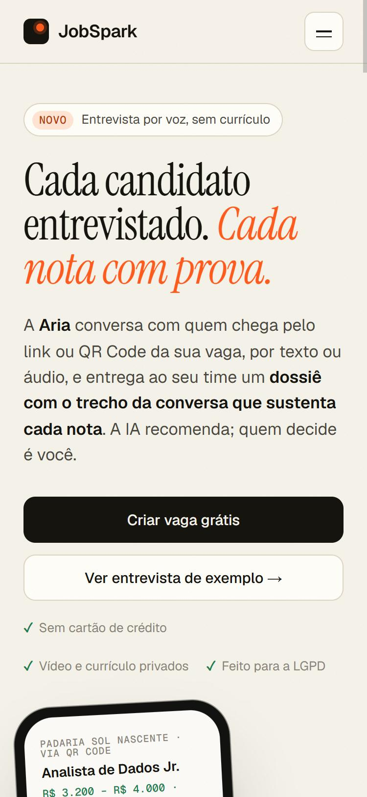 | 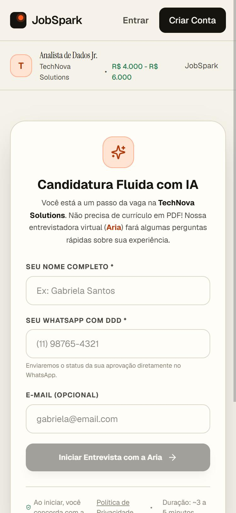 |

### Entrevista dentro do fluxo do site

Quando a empresa move a candidatura para **"Entrevista"**, o candidato vê o botão em **Minhas candidaturas** (também com conta Google). A empresa pode mandar o convite pelo WhatsApp: a mensagem leva um **link** que abre a entrevista direto e um **código** para digitar em `jobspark.com.br/entrevista`, válido por 7 dias.

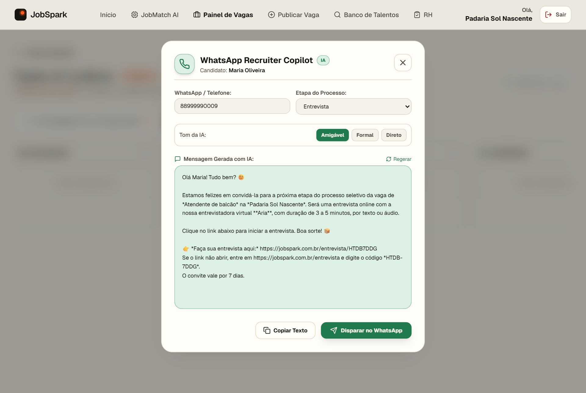

| Minhas candidaturas | Código do convite | A entrevista aberta |
|---|---|---|
| 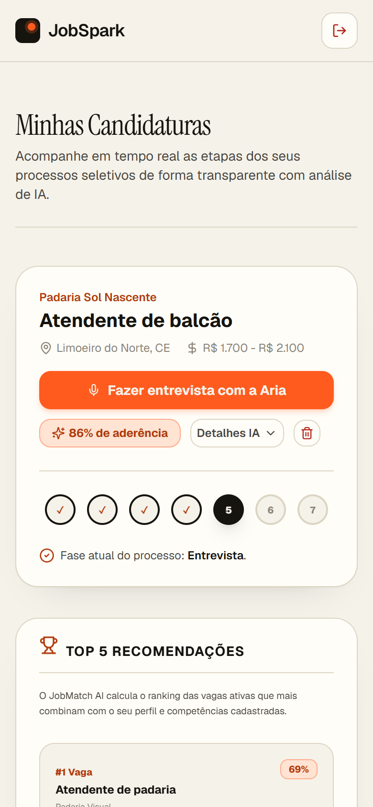 | 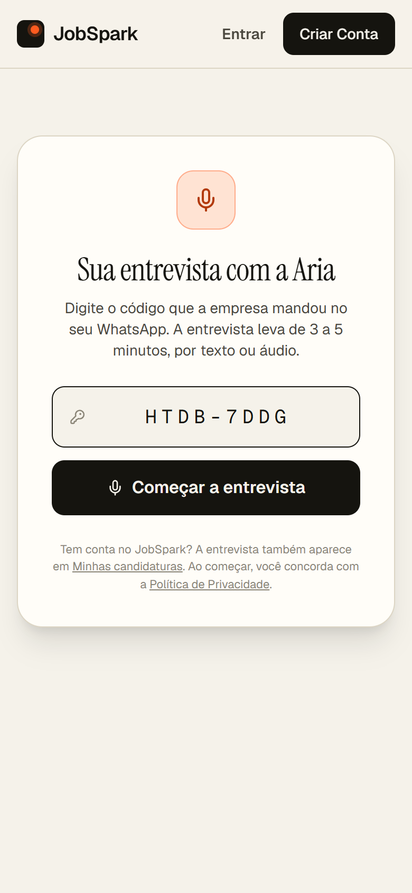 | 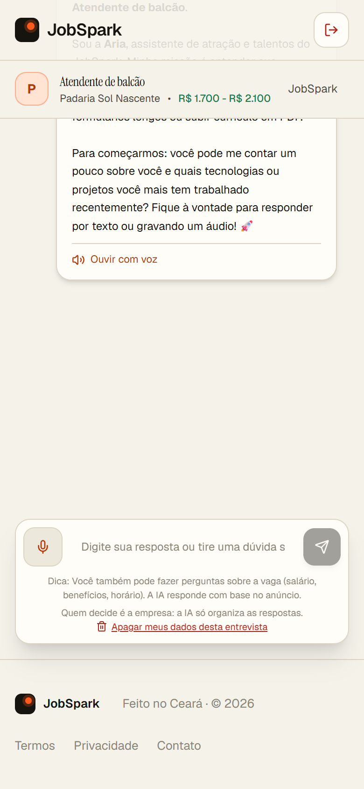 |

**Dossiê do candidato** — nota de 0 a 100 com pontos fortes, pontos de atenção e recomendação; a decisão fica na aba "Ficha do gestor".

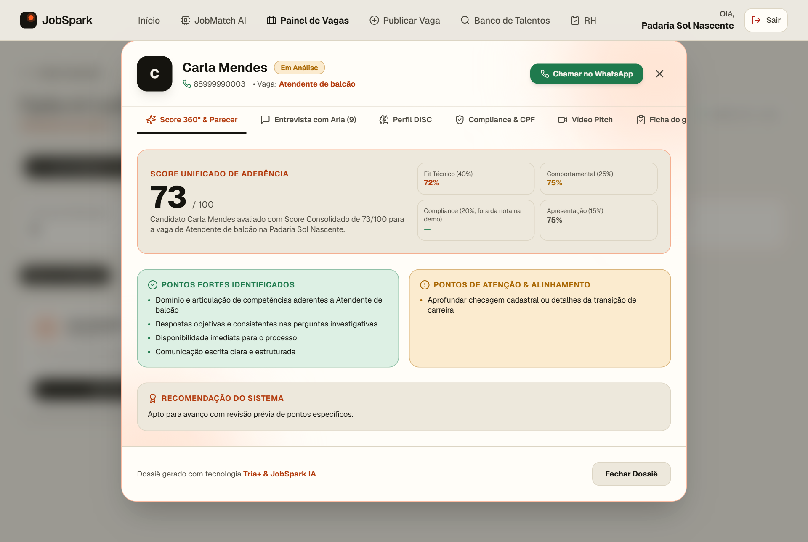

**RH** — indicadores por canal, tempo até contratar, horas economizadas e a admissão com o checklist da CLT.

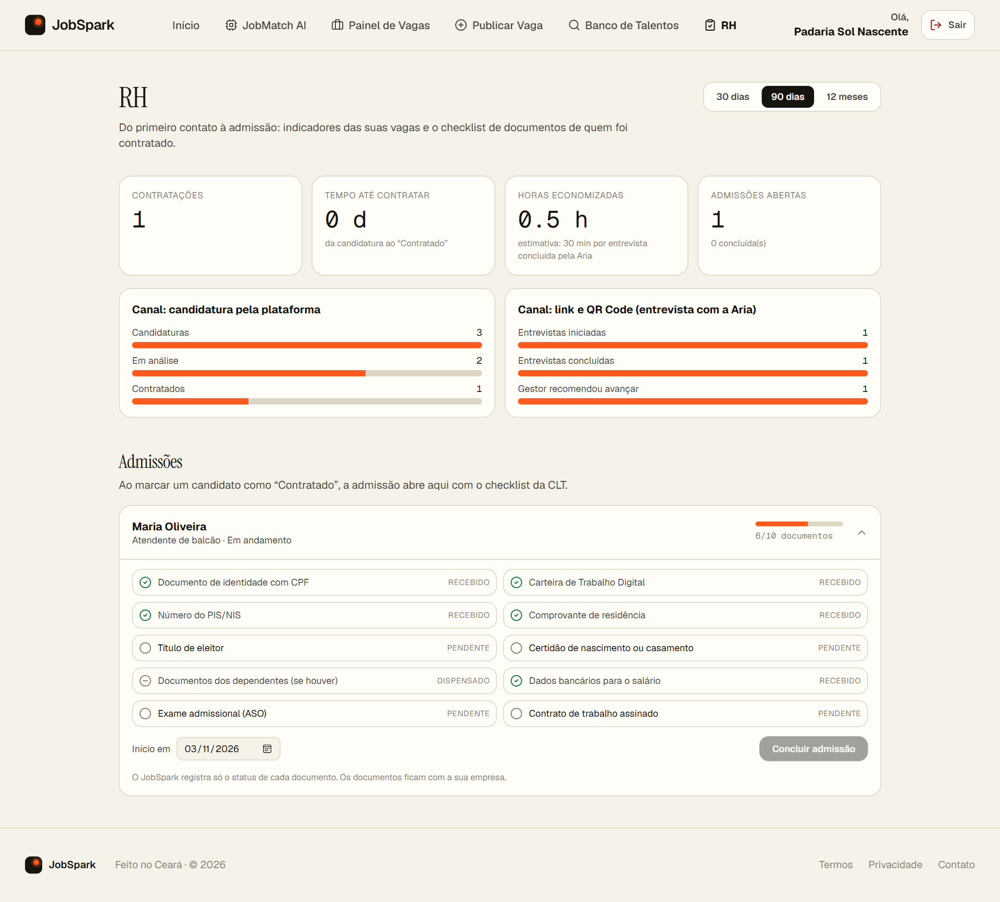

**Banco de talentos** — busca por significado entre quem já passou pelas vagas da empresa.

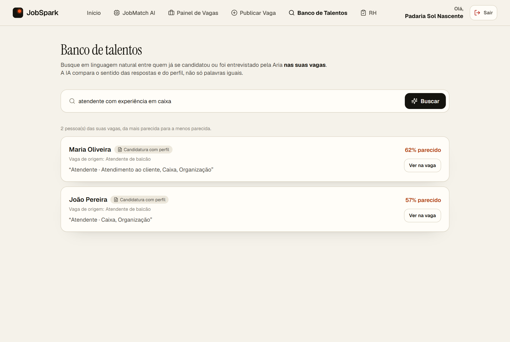

Mais telas: painel de vagas com o uso do plano e pipeline de candidatos

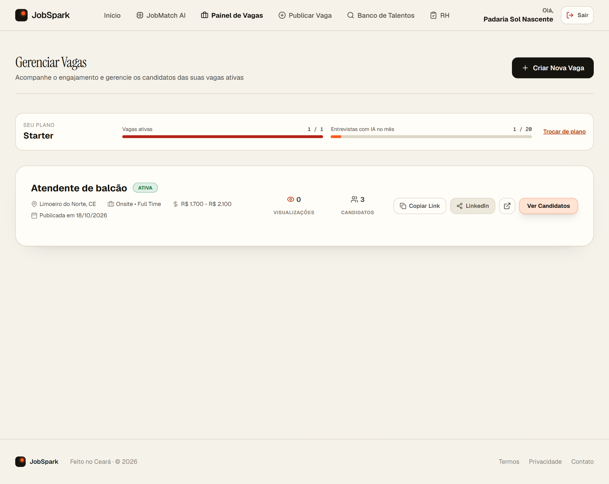
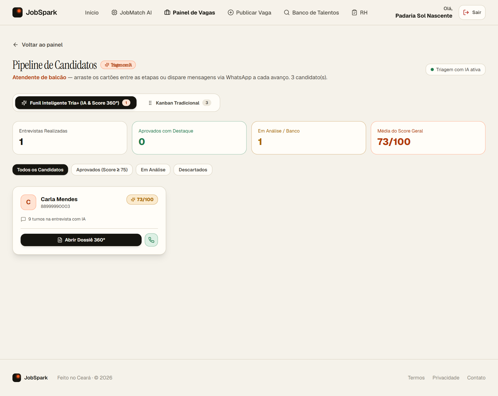

---

## 🏗️ Infraestrutura

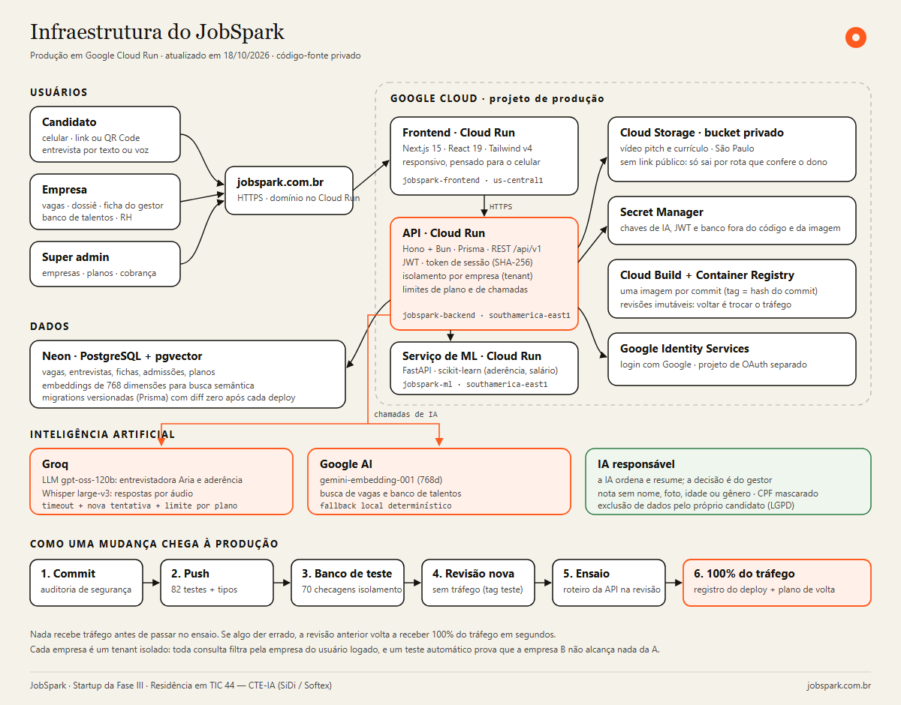

Versão vetorial: [docs/img/infraestrutura.svg](docs/img/infraestrutura.svg).

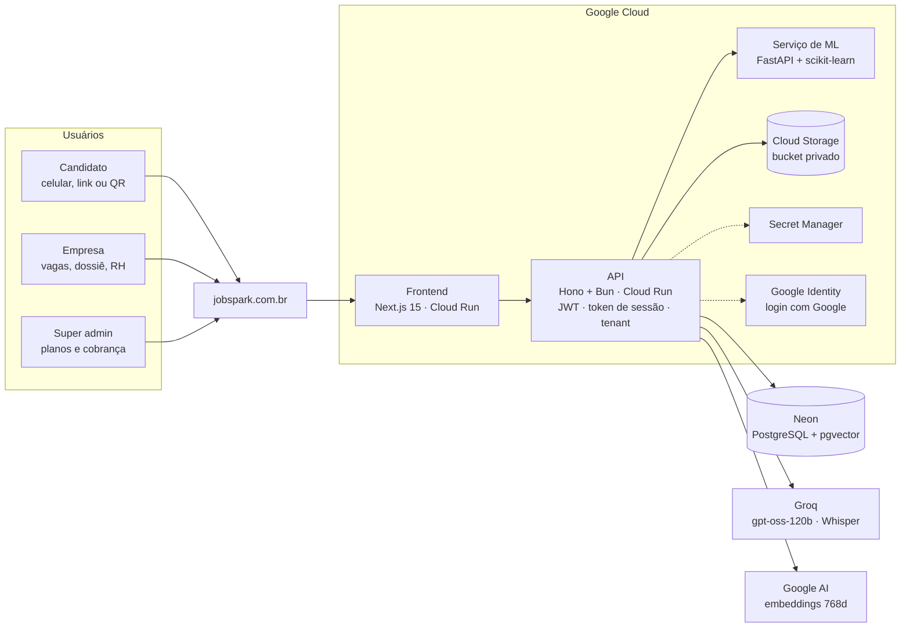

**Como uma mudança chega à produção:** commit com auditoria de segurança → push com testes → ensaio no banco de teste (70 checagens de isolamento entre empresas) → nova revisão no Cloud Run **sem tráfego** → ensaio da API nessa revisão → só então 100% do tráfego, com registro do deploy e plano de volta.

---

## 🧠 Inteligência artificial

| Uso | Como |
|---|---|
| Entrevistadora Aria e análise de aderência | LLM via Groq (`openai/gpt-oss-120b`), com timeout e nova tentativa |
| Respostas por áudio | Whisper large-v3 (Groq) |
| Busca semântica e banco de talentos | Embeddings `gemini-embedding-001` (768d) no PostgreSQL com pgvector |
| Classificador de aderência e estimador de salário | scikit-learn num serviço próprio, treinados hoje com **dados sintéticos**; retreinar com dados reais é meta da Sprint 3 |

**IA responsável:** decisão humana obrigatória (ficha do gestor), nota que não usa nome, foto, idade ou gênero, CPF sempre mascarado, verificação de antecedentes em modo de demonstração (não consulta bases oficiais), exclusão de dados pelo próprio candidato e isolamento entre empresas comprovado por teste.

---

## 💳 Planos

| Plano | Preço | Vagas ativas | Entrevistas com IA por mês |
|---|---|---|---|
| Starter | grátis | 1 | 20 |
| Pro | R$ 290/mês | 5 | 300 |
| Scale | R$ 690/mês | ilimitadas | 1.000 |
| Enterprise | sob contrato | ilimitadas | ilimitadas |

Toda empresa nova começa no Starter e publica a primeira vaga sozinha.

---

## ✅ Qualidade e segurança

| Portão | O que faz |
|---|---|
| 82 testes automatizados | segurança, acesso à sessão, IA, planos, RH, arquivos, robustez, entrevista e convite |
| Auditoria a cada commit | barra rota sem autenticação, rota sem checagem de dono, empresa vinda do corpo da requisição e segredo no código |
| Caça-falhas de isolamento | cria 2 empresas e 2 candidatos e prova, rota por rota, que um não alcança o outro (70 checagens) |
| Deploy com ensaio | revisão nova sem tráfego, ensaio da API, só então 100%; cada deploy registrado com plano de volta |
| LGPD | vídeo e currículo em armazenamento privado, exclusão pelo titular, política com os papéis de controladora e operador |

---

## 🛠️ Stack

| Camada | Tecnologias |
|---|---|
| Frontend | Next.js 15, React 19, Tailwind CSS v4 |
| Backend | Hono, Bun, Prisma 6, JWT |
| Banco | PostgreSQL + pgvector (Neon) |
| IA / ML | Groq (gpt-oss-120b, Whisper), Google gemini-embedding-001, scikit-learn, FastAPI |
| Infra | Google Cloud Run, Cloud Build, Cloud Storage, Secret Manager |

---

## 👤 Autor

**Idarlan Magalhães** — Residente em IA no SiDi / Softex · Limoeiro do Norte, CE
[GitHub](https://github.com/idarlandias) · [LinkedIn](https://www.linkedin.com/in/idarlandias/)

© 2026 Idarlan Magalhães. Todos os direitos reservados. Código-fonte proprietário.

